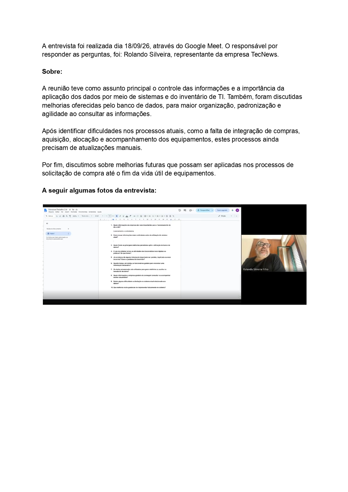
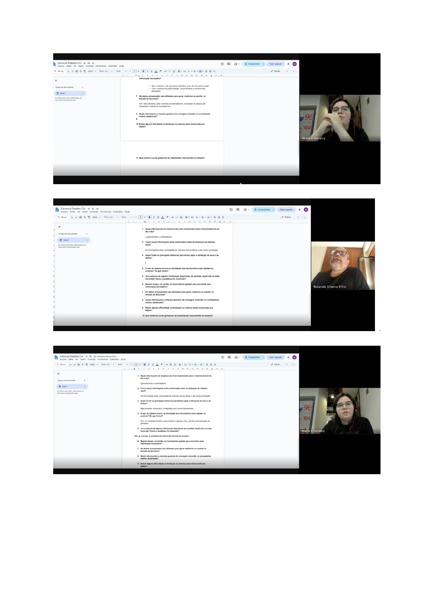

# CNA--Modelo Lógico

## **Integrantes:**

|Nome completo do aluno|RGM|Usuário do Github|
|----------------------|---|------------------|
| Caroline Barroso de Oliveria| 4806351-7|CarolineBarroso|
| Danielly Mariano da Costa| 4781783-6|Elly78992|
| Maria Eduarda Kostkievicz Ferreira| 4790715-1|MadukFerreira|

## 1- **Relatório técnico** 

## **1.1- Revisao do Modelo Conceitual**
O modelo conceitual elaborado na Entrega 1 tinha como objetivo principal representar o controle do inventário de equipamentos de informática da organização CNA, considerando os serviços de suporte técnico realizados pela empresa TecNews. O diagrama contemplava entidades como Colaborador, Equipamento, Compra, Item_Compra, Fornecedor, Validação, Notebook, Celular, Sistema_Operacional e Marca, permitindo representar parte das informações relacionadas ao cadastro e ao acompanhamento dos equipamentos.

Entretanto, durante a avaliação da primeira entrega, foram identificadas limitações na estrutura do modelo conceitual. A principal delas estava relacionada à cobertura incompleta dos processos de negócio da organização, pois o diagrama concentrava-se no inventário e não representava adequadamente outros procedimentos importantes, como aquisição de equipamentos, entrega e devolução aos colaboradores, acionamento de garantia, descarte de equipamentos e controle de licenças de software.

Também foram identificados problemas na organização dos relacionamentos. A especialização de Equipamento em Notebook e Celular apresentava atributos repetidos que já pertenciam à entidade principal, como identificador, número de série e patrimônio. Além disso, alguns relacionamentos não representavam corretamente as regras de negócio: o vínculo entre celular e colaborador permitia uma interpretação inadequada da quantidade de colaboradores associados a um equipamento, e a entidade Serviço não possuía ligação direta com o equipamento atendido. A entidade Validação também apresentava limitações em sua associação com os diferentes tipos de equipamentos. Markdown colado.md

A partir dessas observações, o modelo conceitual foi revisado e ampliado para representar de maneira mais completa os processos relacionados ao gerenciamento dos recursos tecnológicos da organização. A revisão também buscou melhorar a organização das entidades, eliminar redundâncias e estabelecer relacionamentos mais coerentes com as regras de negócio identificadas durante o levantamento de informações.

Entre as principais alterações realizadas, destacam-se:

**1. Controle de colaboradores e departamentos:** foi aprimorada a representação dos colaboradores e incluída a entidade Departamento, permitindo organizar os funcionários de acordo com suas respectivas áreas e relacioná-los aos equipamentos utilizados.

**2. Histórico de alocação de equipamentos:** foi criada a entidade Alocação para registrar a entrega e a devolução dos equipamentos, incluindo datas, situação, observações e condições de devolução. Essa alteração permite acompanhar o histórico de utilização dos equipamentos, em vez de manter apenas um vínculo direto com o colaborador.

**3. Controle de compras:** o processo de aquisição foi ampliado com as entidades Solicitação de Compra, Aprovação de Compra, Cotação, Compra e Item de Compra. Dessa forma, o modelo passou a representar as etapas envolvidas na solicitação, aprovação, cotação e registro das aquisições.

**4. Cadastro de fornecedores:** a entidade Fornecedor foi mantida e integrada aos processos de compra, cotação, serviços e acionamento de garantia, possibilitando identificar as empresas envolvidas no fornecimento de equipamentos e na prestação de serviços.

**5. Controle de chamados e serviços:** a estrutura foi ampliada com as entidades Chamado e Serviço, permitindo registrar solicitações de suporte técnico, atendimentos realizados, datas, prioridades, resultados e equipamentos envolvidos.

**6. Controle de garantia:** foi incluída a entidade Acionamento de Garantia, destinada ao registro das solicitações realizadas aos fornecedores, incluindo protocolo, data, situação e resultado do atendimento.

**7. Controle de software e licenças:** foram acrescentadas as entidades Software, Licença de Software e Licença de Atribuição, permitindo acompanhar os programas utilizados, suas licenças, prazos de validade e atribuições aos colaboradores e equipamentos.

**8. Movimentação e destinação de equipamentos:** foram incluídas as entidades Movimentação_Destinação e Descarte, permitindo registrar alterações de destino, transferências e procedimentos relacionados à retirada de equipamentos do inventário.

**9. Aprimoramento das validações:** a entidade Validação foi reorganizada para registrar informações sobre verificações realizadas nos equipamentos, responsáveis, resultados, alterações e procedimentos de sanitização.

Com essas alterações, o modelo deixou de representar somente o cadastro e o acompanhamento básico dos equipamentos e passou a abranger diferentes etapas do ciclo de vida dos recursos tecnológicos, desde a solicitação de compra até a utilização, manutenção, movimentação e destinação final.

A revisão também buscou corrigir os problemas de relacionamento identificados na primeira entrega, evitando a repetição desnecessária de atributos e melhorando a representação das associações entre as entidades. O modelo revisado serviu como base para a elaboração do modelo lógico, do processo de normalização e da estrutura do banco de dados.

## **Caracterização da Organização:**  
A organização utilizada como referência para o desenvolvimento do projeto é o CNA, uma instituição que atua como franqueadora e centro de operações pedagógicas, administrativas, tecnológicas e financeiras para sua rede de ensino. Os serviços de suporte técnico e infraestrutura de tecnologia da informação são prestados pela empresa TecNews, responsável por atividades como Suporte N1 e N2, Service Desk, Help Desk, monitoramento de links e sites, além de suporte e gerenciamento de redes.

A unidade estudada possui porte corporativo médio/grande e conta com mais de 340 equipamentos ativos de tecnologia da informação, utilizados por colaboradores de diferentes setores. Entre os dispositivos utilizados estão notebooks, celulares e linhas telefônicas corporativas.

A organização necessita manter informações atualizadas sobre seus equipamentos, colaboradores, departamentos, softwares, licenças, fornecedores, garantias e movimentações patrimoniais. Esses dados são importantes para o acompanhamento dos recursos tecnológicos e para auxiliar na tomada de decisões administrativas e operacionais.

Durante o levantamento de informações, foram identificadas algumas dificuldades relacionadas ao controle dos dados, como duplicidade de cadastros de equipamentos, registros incorretos e informações de colaboradores desligados. Também foi identificada a necessidade de melhorar a integração entre os dados de hardware, software, garantias, linhas telefônicas e informações financeiras, como notas fiscais e custos

- **Nome e natureza da organização:**
A organização selecionada para o desenvolvimento do projeto é a CNA, que utiliza recursos tecnológicos para apoiar suas atividades. A organização conta com o suporte da empresa TecNews, responsável pela prestação de serviços relacionados à tecnologia da informação.

- **Contexto e porte:**
O levantamento realizado identificou que o controle dos equipamentos tecnológicos da CNA é feito por meio de uma planilha oficial de inventário, que reúne informações dos colaboradores e dos equipamentos utilizados, incluindo notebooks e celulares.
A planilha analisada possui aproximadamente 997 linhas e 26 colunas, considerando a estrutura total da planilha, incluindo cabeçalhos e campos. Os registros abrangem informações cadastrais dos colaboradores, características técnicas dos equipamentos, números de patrimônio, números de série, situação dos dispositivos e dados relacionados à conferência do inventário.
As atualizações são realizadas manualmente, e o volume de consultas e alterações é relativamente baixo. Essas características indicam a necessidade de uma solução capaz de organizar os registros, facilitar as consultas e padronizar o armazenamento das informações.
A CNA também conta com o suporte tecnológico da empresa TecNews, que oferece serviços de TI. Entretanto, as solicitações de atendimento e os registros de manutenção são controlados por outro sistema, ao qual o grupo não possui acesso. Por esse motivo, essas informações não fazem parte do escopo do banco de dados desenvolvido neste projeto.
- **Problemas e necessidades identificados:**
Durante o levantamento de informações, foram identificadas dificuldades relacionadas ao controle e à organização dos dados dos equipamentos. Entre os problemas relatados, destacam-se a existência de registros duplicados, informações incorretas e dados de colaboradores desligados que permaneciam nos controles.

Também foi identificada a necessidade de melhorar o acompanhamento do histórico dos equipamentos, permitindo identificar quem utilizou determinado recurso, quando ocorreu sua entrega ou devolução, quais manutenções foram realizadas e qual é sua situação atual.

Além disso, a organização necessita acompanhar informações relacionadas a:
- Inventário de equipamentos: identificação, modelo, fabricante, número de série, patrimônio, características técnicas e situação.
- Colaboradores e departamentos: identificação dos funcionários e das áreas às quais pertencem.
- Alocação de equipamentos: registro das entregas, devoluções e condições dos equipamentos.
- Aquisições: controle das solicitações, aprovações, cotações, compras, notas fiscais e fornecedores.
- Garantias: acompanhamento dos prazos e dos acionamentos realizados junto aos fornecedores.
- Suporte técnico: registro dos chamados, serviços realizados, responsáveis e resultados dos atendimentos.
- Licenças de software: controle dos programas utilizados, quantidade de licenças, validade e atribuições.
- Movimentação e descarte: acompanhamento das transferências, alterações de destino, descarte e aproveitamento de componentes.
- **Escopo do sistema:**
  O sistema proposto tem como objetivo organizar e centralizar as informações relacionadas ao inventário de equipamentos tecnológicos utilizados pelos colaboradores da CNA. A solução contempla o cadastro de colaboradores, departamentos, equipamentos, características técnicas, identificação patrimonial, garantias, situação dos dispositivos, atribuições, devoluções e histórico de alterações.
Também são considerados os registros relacionados a fornecedores, aquisições e licenças de software, conforme as entidades previstas no modelo de dados.
 O sistema não tem como finalidade substituir a plataforma externa utilizada pela TecNews para controlar solicitações de atendimento e manutenção. Dessa forma,   o projeto concentra-se na organização dos dados do inventário e no acompanhamento das informações necessárias à gestão dos ativos tecnológicos.

- **Justificativa da escolha:**
A CNA foi escolhida por ser uma organização à qual o grupo teve acesso para realizar o levantamento de informações. A pesquisa de campo foi realizada por meio de entrevista com um representante da empresa TecNews, possibilitando compreender o contexto tecnológico e o processo de controle do inventário.

- **Evidência da organização:**
  A organização escolhida para o desenvolvimento do projeto é a CNA. A evidência do levantamento consiste na planilha oficial de inventário disponibilizada para análise e nas informações obtidas durante a entrevista com um representante da empresa TecNews, responsável pelo suporte tecnológico da CNA.

- **Responsável pela organização:** Rolando Silveira, +55 11 99654-1867

## **Relato da entrevista**

- **Quem:** A entrevista foi realizada com Rolando Silveira, representante da empresa TecNews.
  
- **Quando e onde:** Foi realizada 18/09/26, através do Google Meet. Devido que o representante da empresa mora em Portugal, as informações foram obtidas através do entrevistado de forma remota.  
- **Comprovação:**   
- **O que foi levantado:**  O levantamento foi realizado por meio de duas entrevistas com representante da organização TecNews, permitindo compreender o funcionamento do controle de equipamentos e das informações de TI. Foi identificado que a organização possui mais de 340 equipamentos ativos, entre notebooks e dispositivos móveis, e utiliza um inventário para registrar informações sobre equipamentos, colaboradores, licenciamento, garantias, aquisições e manutenção.
A primeira entrevista identificou dificuldades relacionadas à organização, duplicidade e integração das informações. A segunda complementou esses dados, detalhando o processo de solicitação, aprovação, compra, cadastro, manutenção e descarte dos equipamentos.
Como principal melhoria futura, foi identificada a necessidade de integrar o sistema de compras ao inventário de TI, possibilitando o registro automático dos equipamentos a partir da emissão da nota fiscal.
O levantamento completo, com a descrição dos processos, informações coletadas e comparação entre as entrevistas, está em [Levantamento das informações](levantamento/levantamento.md)

## **Processos de Negócios:** 
O principal processo identificado na CNA consiste no levantamento, registro e atualização das informações referentes aos equipamentos tecnológicos utilizados pelos colaboradores, abrangendo notebooks e celulares.
Atualmente, o controle do inventário é realizado por meio de uma planilha oficial, que reúne informações dos colaboradores, características dos equipamentos, identificação patrimonial, situação de uso e dados referentes à conferência do inventário.
O processo contempla a identificação dos equipamentos vinculados aos colaboradores, o preenchimento e a atualização de seus dados cadastrais e técnicos, além do registro das informações de conferência disponíveis na planilha.

A CNA também conta com o suporte tecnológico da empresa TecNews. Entretanto, as solicitações de atendimento e os registros de manutenção são controlados por outro sistema, ao qual o grupo não possui acesso. Por esse motivo, tais informações não integram o escopo da modelagem proposta.
Dessa forma, o banco de dados desenvolvido pelo grupo tem como objetivo organizar e centralizar as informações do inventário, contribuindo para a padronização dos registros, a consulta dos equipamentos e o acompanhamento de suas situações.

 ## **Requisitos**

 - **Requisitos Funcionais:**
 
 **RF01- Cadastro de equipamentos:** O sistema deve permitir o cadastro de notebooks e celulares, registrando, conforme o tipo, modelo, fabricante, endereço IP quando aplicável, número de serie, patrimônio e data de aquisição.
 
 **RF02 - Registro de garantia:** O sistema deve permitir registrar as informações de garantia de cada equipamento, incluindo período de cobertura, datas de início e término e data de fabricação, quando disponível. 

 **RF03 - Observações de uso:** O sistema deve permitir registrar e consultar observações relacionadas ao uso dos equipamentos e ao colaborador responsável por sua utilização.

 **RF04 - Situação dos equipamentos:** O sistema deve permitir registrar e consultar a situação de cada equipamento, incluindo, no mínimo, disponível em estoque, em uso, em manutenção, com defeito e destinado ao descarte.

  **RF05 - Histórico de alterações:** O sistema deve manter histórico detalhado dos cadastros e das alterações realizadas nos equipamentos, identificando data, horário e responsável por cada operação.

  **RF06 - Consulta e atualização de equipamentos:** O sistema deve permitir pesquisar e visualizar os equipamentos cadastrados, atualizar seus dados conforme as permissões do usuário e consultar a disponibilidade do estoque.

  **RF07 - Registro de solicitações de suporte:** O sistema deve registrar solicitações de suporte relacionadas aos equipamentos, identificando o nível de atendimento (N1, N2 ou Help Desk), a descrição da solicitação, o status e os responsáveis pelo atendimento.

  **RF08 - Devolução de equipamentos:** O sistema deve permitir registrar a devolução de equipamentos vinculados aos colaboradores, mantendo a data de devolução, a condição do ativo e a atualização de sua situação no inventário. 

  **RF09 - Manutenção e fornecedores:** O sistema deve permitir registrar manutenções e serviços realizados em cada equipamento, associando o serviço ao fornecedor responsável e as informações de garantia ou contrato aplicáveis.    

  **RF10 - Descarte de equipamentos:** O sistema deve permitir registrar a destinação de equipamentos descartados, incluindo a confirmação de sanitização dos dados e as informações necessárias para rastrear o descarte. 

  **RF11 - Controle de licenças de software:** O sistema deve permitir registrar os softwares instalados em cada equipamento e os dados de suas respectivas licenças, incluindo identificação, validade e situação.   
  
 - **Requisitos Não Funcionais:**

   **RNF01 - Controle de acesso:** O sistema deve restringir o acesso aos dados e as operações de inclusão, consulta, alteração e exclusão logica aos operadores e administradores autorizados pela empresa, conforme seus perfis de permissão.

     **RNF02 - Integridade do histórico:** O sistema deve garantir que os registros de histórico e validação sejam permanentes e não possam ser alterados ou excluídos por usuários comuns ou administradores da aplicação.

   **RN03 - Desempenho:** O sistema deve responder as consultas de inventario em ate 2 segundos, considerando condições normais de operação e carga de uso prevista.      

 - **Levantamento dos requisitos típicos do tipo de organização.**
 
 - **Justificação dos requisitos prováveis não incluídos:**
   A organização escolhida para o desenvolvimento do projeto é a CNA. A evidência do levantamento consiste na planilha oficial de inventário disponibilizada para análise e nas informações obtidas durante a entrevista com um representante da empresa TecNews, responsável pelo suporte tecnológico da CNA.

## **Regras de negócio:**
As regras de negócio foram definidas considerando a necessidade de manter o inventário atualizado, garantir a identificação dos equipamentos, controlar a responsabilidade dos colaboradores e preservar o histórico das movimentações.

Entre as regras identificadas estão a alocação exclusiva de equipamentos, a obrigatoriedade de registrar devoluções, a manutenção do histórico de alterações, o controle das garantias e a utilização de licenças válidas para os softwares registrados.

- **Levante as regras típicas do tipo de organização.**

  **RN01 - Alocação exclusiva:** Um equipamento pode estar vinculado, no máximo, a um colaborador por vez. A alocação deve ser registrada e, antes de uma nova alocação, a alocação anterior deve ser encerrada.

  **RN02 - Histórico de validação:** Toda inclusão ou alteração de dados de um equipamento, incluindo mudança de situação, alocação, manutenção e atualização cadastral, deve gerar um registro permanente e imutável no histórico, contendo data, hora e identificação do responsável.

  **RN03 - Devolução no desligamento:** Quando ocorrer o desligamento de um colaborador, todos os equipamentos sob sua responsabilidade devem ser devolvidos e sua alocação encerrada no inventário.

  **RN04 - Garantia e manutenção:** Toda manutenção deve ser registrada e associada ao equipamento atendido e ao fornecedor responsável. Quando houver garantia ou contrato ativo aplicável, o atendimento deve ser vinculado a esse registro e respeitar suas condições.

  **RN05 - Descarte e proteção de dados:** Todo equipamento destinado ao descarte deve passar por sanitização dos dados antes de sua destinação final. O descarte deve seguir a politica interna de resíduos eletrônicos e os requisitos aplicáveis de proteção de dados e LGPD.

  **RN06 - Controle de licenciamento:** Todo software instalado em um equipamento deve possuir uma licença válida e registrada no inventário, compatível com o uso realizado e com a quantidade de instalações autorizadas.     

- **Justifique as regras prováveis não incluídas:**
  Não foram definidas regras detalhadas para o fluxo de atendimento técnico, priorização de chamados, distribuição de técnicos, controle de SLA e execução de serviços de manutenção, pois esses procedimentos pertencem ao sistema externo de suporte da TecNews. Também não foram estabelecidas regras específicas para aprovação financeira de compras, negociação com fornecedores ou procedimentos administrativos de descarte que não tenham sido confirmados no levantamento realizado.

## **Notação do DER conceitual**

**Software Utilizado:** BrModelo

|Apontamento da correção da E1|O que mudou no trabalho|Por quê|
|----------------------|---|------------------|
|O modelo precisava representar melhor os processos da organização, e não apenas o controle básico dos equipamentos. |O DER foi ampliado para contemplar aquisição, utilização, manutenção, garantia, movimentação e descarte de equipamentos.| Para representar de forma mais completa o ciclo de vida dos equipamentos e atender aos requisitos levantados.|
|Necessidade de melhorar o controle de compras e aquisições de equipamentos. |Foram incluídas as entidades Solitacao_compra, Aprovacao_compra, Cotacao, Compra e Item_compra, relacionadas ao Fornecedor. |Para acompanhar solicitações, aprovações, cotações, compras e itens adquiridos, mantendo o histórico das operações.|
|Necessidade de melhorar o controle dos colaboradores e equipamentos vinculados. |Foram organizadas as entidades Colaborador, Departamento, Equipamento e Alocacao, incluindo entrega, devolução e situação dos equipamentos. |Para identificar os responsáveis pelos equipamentos e manter o histórico de utilização, entrega e devolução.|
|Necessidade de representar o controle de fornecedores e serviços realizados. |Foram estruturadas as entidades Fornecedor, Chamado e Servico, relacionando atendimentos, colaboradores, equipamentos e fornecedores. |Para acompanhar chamados técnicos, serviços executados e atendimentos realizados por empresas terceirizadas.|
|Necessidade de controlar as licenças dos softwares utilizados pela organização. |Foram incluídas as entidades Software, Licenca_software e Licenca_atribuicao. |Para registrar os softwares, controlar quantidade e validade das licenças e identificar suas atribuições.|  
|Necessidade de melhorar o acompanhamento das movimentações e da destinação dos equipamentos. |Foram estruturadas as entidades Movimentacao_destinacao, Validacao e Descarte. |Para registrar movimentações patrimoniais, validações e informações referentes ao descarte dos equipamentos.|      
|O modelo precisava apresentar melhor organização e identificação dos relacionamentos entre as entidades. |O DER foi reorganizado, com revisão dos relacionamentos, cardinalidades e identificação das chaves primárias e estrangeiras na conversão para o modelo lógico. |Para facilitar a compreensão da estrutura do banco, reduzir ambiguidades e garantir a integridade das informações.|          

## **1.2 Conversão do Modelo Conceitual para o Modelo Lógico**

- **Entidades → Tabelas:**
  As entidades identificadas no modelo conceitual foram transformadas em tabelas no modelo lógico. Cada tabela representa um elemento importante do domínio do problema, como colaboradores, departamentos, equipamentos, fornecedores, compras e licenças de software.

- **Atributos → Colunas:**
  Os atributos das entidades foram convertidos em colunas das respectivas tabelas, com tipos de dados adequados à informação armazenada. Foram considerados campos numéricos, textos, datas e identificadores, conforme a finalidade de cada atributo.

- **Relacionamentos → Chaves:**
  Os relacionamentos entre as entidades foram representados por meio de chaves estrangeiras. Essas chaves permitem associar os registros das diferentes tabelas, mantendo a integridade referencial do banco de dados.

- **Cardinalidades:**
 As cardinalidades definidas no modelo conceitual foram consideradas durante a transformação dos relacionamentos para o modelo lógico. Nos relacionamentos de um para muitos, a chave estrangeira é posicionada na tabela correspondente ao lado muitos. Nos relacionamentos de um para um, a implementação deve garantir a associação adequada entre os registros, utilizando restrições de unicidade quando necessário.

Nos relacionamentos de muitos para muitos, a utilização de uma tabela associativa permite armazenar as referências das entidades envolvidas e representar corretamente as associações.

- **Generalização/especialização:**
  A generalização e a especialização foram consideradas para representar categorias de equipamentos que compartilham características comuns, mas possuem atributos específicos.

No contexto do projeto, notebooks e celulares possuem informações gerais em comum, como identificação patrimonial, fabricante, modelo e situação, mas também podem apresentar características particulares.

A organização dessas informações deve respeitar a estrutura efetivamente adotada no modelo lógico, mantendo os dados comuns na estrutura geral e os dados específicos nas tabelas correspondentes, caso a especialização tenha sido implementada dessa forma.

## **1.3 Definição de Chaves Primárias e Estrangeiras**
As chaves primárias foram definidas para identificar exclusivamente cada registro das tabelas, evitando duplicidade e permitindo localizar os dados de maneira precisa.

As chaves estrangeiras foram utilizadas para estabelecer os relacionamentos entre as tabelas e garantir que os registros relacionados pertençam a entidades existentes no banco de dados.

A definição das chaves considera as seguintes finalidades:
- Identificar individualmente colaboradores, equipamentos, departamentos e demais registros.
- Relacionar equipamentos aos colaboradores responsáveis por sua utilização.
- Associar equipamentos aos seus fabricantes, fornecedores e informações de aquisição, quando aplicável.
- Relacionar licenças aos softwares e equipamentos correspondentes.
- Registrar o histórico de movimentações e alterações dos equipamentos.
- Garantir a integridade dos relacionamentos entre as tabelas.

## **1.4 Processo de Normalização (1FN, 2FN e 3FN)**

- **1FN:**
- Colaborador: os dados pessoais e corporativos foram separados em atributos específicos, como nome, sobrenome, email_corporativo e data_admissao.
- Equipamento: cada característica do equipamento foi armazenada em um campo próprio, como patrimonio, numero_serie, fabricante, modelo, processador e memoria_ram.
- Fornecedor: as informações de identificação e contato foram organizadas em campos individuais, como nome, tipo_fornecedor, telefone e email.
- Item_compra: cada item possui sua própria identificação, descrição, quantidade e valor unitário, evitando reunir diferentes produtos em um único campo.
- Celular: informações específicas dos dispositivos móveis, como linha_telefonica, imei_1 e imei_2, foram organizadas em atributos próprios.

- **2FN:**
- Colaborador e Departamento: os dados do departamento foram mantidos na tabela Departamento, enquanto a tabela Colaborador armazena o identificador do departamento ao qual o funcionário está vinculado.
- Software e Licenca_software: os dados de identificação do software foram separados das informações referentes às licenças, como quantidade, tipo, data de início, validade e status.
- Compra e Item_compra: os dados gerais da aquisição foram organizados na tabela Compra, enquanto os produtos ou equipamentos adquiridos foram registrados individualmente em Item_compra.
- Solicitacao_compra e Cotacao: as informações da solicitação foram separadas dos dados das cotações recebidas dos fornecedores.

- **3FN:**
- Colaborador e Departamento: o nome do departamento é armazenado na tabela Departamento, enquanto a tabela Colaborador mantém apenas a referência ao departamento por meio da chave estrangeira id_departamento. Assim, alterações no nome do departamento não exigem atualizações em todos os registros dos colaboradores.
- Fornecedor e Cotacao: os dados cadastrais dos fornecedores ficam concentrados na tabela Fornecedor, enquanto a tabela Cotacao registra as informações das propostas comerciais e referencia o fornecedor responsável.
- Software e Licenca_software: as informações de identificação do software ficam na tabela Software, enquanto os dados específicos das licenças são armazenados em Licenca_software.
- Equipamento e Alocacao: os dados permanentes de identificação e configuração dos equipamentos ficam na tabela Equipamento, enquanto as informações sobre entrega, devolução e situação da utilização são registradas em Alocacao.
- Chamado e Servico: as informações da solicitação de suporte são armazenadas na tabela Chamado, enquanto os serviços executados durante o atendimento são registrados separadamente na tabela Servico.

- **Justificativa do processo:**
A aplicação dos princípios de normalização tem como finalidade melhorar a organização do banco de dados e reduzir problemas relacionados à duplicidade de informações.

A separação dos dados em tabelas relacionadas permite que cada informação seja armazenada em seu local apropriado, diminuindo a possibilidade de inconsistências durante operações de inclusão, alteração e exclusão.

Além disso, a normalização contribui para facilitar a manutenção do sistema e melhorar a integridade das informações armazenadas.

No contexto da CNA, essa organização é importante porque o inventário reúne diferentes informações sobre colaboradores, departamentos e equipamentos, que precisam permanecer relacionadas de maneira consistente.

## **1.5 Justificativas Técnicas das Decisões**

- **Justificar as chaves primárias escolhidas.**
As chaves primárias foram definidas para identificar exclusivamente cada registro armazenado nas tabelas do banco de dados da TecNews. Para isso, foi adotado o tipo de dado INT, permitindo a utilização de identificadores numéricos próprios para cada entidade.

Essa escolha evita que informações descritivas, como nomes, modelos, números de série ou e-mails, sejam utilizadas como identificadores principais, uma vez que esses dados podem sofrer alterações ao longo do tempo.

**No modelo, cada entidade possui sua própria chave primária, conforme sua finalidade:**

- **Departamento:** id_departamento, identifica individualmente cada departamento da empresa.

- **Colaborador:** id_colaborador, identifica cada funcionário cadastrado.

- **Equipamento:** id_equipamento, identifica cada equipamento pertencente ao patrimônio tecnológico.

- **Alocacao:** id_alocacao, identifica cada registro de entrega e devolução de equipamentos.

- **Chamado:** id_chamado, identifica individualmente as solicitações de suporte.

- **Servico:** id_servico, identifica cada serviço executado.

- **Fornecedor:** id_fornecedor, identifica cada fornecedor cadastrado.

- **Solicitacao_compra:** id_solicitacao_compra, identifica cada solicitação de aquisição.

- **Aprovacao_compra:** id_aprovacao, identifica cada registro de aprovação de compra.

- **Cotacao:** id_cotacao, identifica cada cotação realizada.

- **Compra:** id_compra, identifica cada aquisição efetuada.

- **Item_compra:** id_item_compra, identifica individualmente cada item de uma compra.

- **Software:** id_software, identifica os programas cadastrados.

- **Licenca_software:** id_licenca_software, identifica cada licença de software registrada.

- **Licenca_atribuicao:** id_licenca_atribuicao, identifica cada atribuição de licença.

- **Movimentacao_destinacao:** id_movimentacao_destinacao, identifica cada movimentação ou alteração de destinação de um equipamento.

- **Validacao:** id_validacao, identifica cada registro de validação.

- **Descarte:** id_descarte, identifica cada processo de descarte.

- **Acionamento_garantia:** id_acionamento_garantia, identifica cada acionamento de garantia.

Nas tabelas especializadas Notebook e Celular, o identificador id_equipamento também é utilizado como chave estrangeira para manter a associação com a entidade principal Equipamento. Essa decisão permite armazenar características específicas de cada categoria sem duplicar os dados gerais dos equipamentos. Portanto, a utilização de chaves primárias numéricas proporciona identificação consistente, organização e facilidade de manutenção dos registros.

-  **Justificar as chaves estrangeiras e os relacionamentos que elas implementam.**
As chaves estrangeiras (FKs) foram utilizadas para estabelecer relações entre as tabelas do banco de dados da TecNews, garantindo a integridade referencial e permitindo que as informações sejam relacionadas de maneira organizada e consistente.

A definição desses relacionamentos foi baseada nas informações levantadas durante a entrevista e nos processos identificados na organização, como o controle de colaboradores, departamentos, equipamentos, alocações, compras, fornecedores, licenças de software, chamados técnicos, manutenções e descartes.

Cada chave estrangeira referencia a chave primária de outra tabela, evitando que sejam registrados dados relacionados a informações inexistentes. Dessa forma, o banco de dados consegue representar os processos da empresa e manter o histórico das operações realizadas.
Justificativa dos relacionamentos

**1. Colaborador e Departamento**
- Chave estrangeira: Colaborador.id_departamento.
- Relacionamento: Departamento (1) para Colaborador (N).
Essa chave estrangeira permite identificar a qual departamento cada colaborador pertence. Conforme as informações levantadas, é necessário manter o cadastro dos funcionários e identificar sua área de atuação dentro da organização. Um departamento pode possuir vários colaboradores, enquanto cada colaborador está associado a um departamento.

**2. Alocação e Colaborador**
- Chave estrangeira: Alocacao.id_colaborador.
- Relacionamento: Colaborador (1) para Alocação (N).
Essa relação permite registrar quais equipamentos foram entregues a cada colaborador. A tabela Alocação mantém informações como data de entrega, data de devolução, situação e condição de devolução, possibilitando acompanhar o histórico de utilização dos equipamentos pelos funcionários.

**3. Alocação e Equipamento**
- Chave estrangeira: Alocacao.id_equipamento.
- Relacionamento: Equipamento (1) para Alocação (N).
Essa chave estrangeira identifica qual equipamento está associado a cada registro de alocação. Sua utilização permite acompanhar as entregas, devoluções e movimentações dos equipamentos, mantendo o histórico de utilização de cada patrimônio.

**4. Validação e Equipamento**
- Chave estrangeira: Validacao.id_equipamento.
- Relacionamento: Equipamento (1) para Validação (N).
Essa relação permite registrar as validações realizadas sobre cada equipamento, incluindo o responsável, a data, o resultado e as observações. Também possibilita acompanhar procedimentos como verificações técnicas e sanitização dos dispositivos antes de sua destinação.

**5. Validação e Movimentação de Destinação**
- Chave estrangeira: Validacao.id_movimentacao_destinacao.
- Relacionamento: Movimentação de Destinação (1) para Validação (N).
Essa chave permite relacionar uma validação ao processo de movimentação ou destinação correspondente. Dessa forma, é possível manter registros das verificações realizadas durante os procedimentos de transferência, reutilização ou descarte de equipamentos.

**6. Movimentação de Destinação e Equipamento**
- Chave estrangeira: Movimentacao_destinacao.id_equipamento.
- Relacionamento: Equipamento (1) para Movimentação de Destinação (N).
Essa relação permite registrar as movimentações realizadas com cada equipamento, identificando sua destinação, data e descrição. É importante para manter o histórico patrimonial e acompanhar o destino dos dispositivos ao longo de seu ciclo de vida.

**7. Descarte e Equipamento**
- Chave estrangeira: Descarte.id_equipamento.
- Relacionamento: Equipamento (1) para Descarte (N).
Essa chave estrangeira identifica qual equipamento está associado ao registro de descarte. Permite documentar a data, o motivo e as observações referentes à retirada definitiva de um dispositivo do inventário.

**8. Descarte e Movimentação de Destinação**
- Chave estrangeira: Descarte.id_movimentacao_destinacao.
- Relacionamento: Movimentação de Destinação (1) para Descarte (N).
Essa relação conecta o registro de descarte à movimentação de destinação correspondente, permitindo identificar o processo pelo qual o equipamento foi encaminhado para sua destinação final.

**9. Licença de Software e Software**
- Chave estrangeira: Licenca_software.id_software.
- Relacionamento: Software (1) para Licença de Software (N).
Essa chave permite identificar a qual software pertence cada licença cadastrada. Conforme as necessidades levantadas, a organização precisa controlar os programas utilizados, suas versões, quantidades de licenças e respectivos períodos de validade.

**10. Atribuição de Licença e Colaborador**
- Chave estrangeira: Licenca_atribuicao.id_colaborador.
- Relacionamento: Colaborador (1) para Atribuição de Licença (N).
Essa relação permite identificar quais licenças de software foram atribuídas a cada colaborador, possibilitando acompanhar a utilização dos recursos de software pelos funcionários.

**11. Atribuição de Licença e Equipamento**
- Chave estrangeira: Licenca_atribuicao.id_equipamento.
- Relacionamento: Equipamento (1) para Atribuição de Licença (N).
Essa chave permite identificar em qual equipamento uma licença foi utilizada. Sua implementação contribui para o controle dos softwares instalados e para o acompanhamento dos recursos tecnológicos vinculados aos dispositivos.

**12. Atribuição de Licença e Licença de Software**
- Chave estrangeira: Licenca_atribuicao.id_licenca_software.
- Relacionamento: Licença de Software (1) para Atribuição de Licença (N).
Essa relação identifica qual licença cadastrada está sendo atribuída a determinado colaborador ou equipamento. Permite controlar a quantidade de licenças disponíveis e acompanhar seus períodos de utilização.

**13. Solicitação de Compra e Colaborador**
- Chave estrangeira: Solicitacao_compra.id_colaborador.
- Relacionamento: Colaborador (1) para Solicitação de Compra (N).
Essa chave permite identificar o colaborador responsável pela solicitação de compra. Sua utilização possibilita acompanhar a origem das solicitações, os motivos apresentados e seus respectivos status.

**14. Aprovação de Compra e Solicitação de Compra**
- Chave estrangeira: Aprovacao_compra.id_solicitacao_compra.
- Relacionamento: Solicitação de Compra (1) para Aprovação de Compra (N).
Essa relação permite vincular as aprovações às solicitações de compra correspondentes. Considerando o processo levantado, as aquisições precisam passar por uma etapa de análise e aprovação antes de serem realizadas, permitindo registrar o resultado e as observações dessa etapa.

**15. Cotação e Solicitação de Compra**
- Chave estrangeira: Cotacao.id_solicitacao_compra.
- Relacionamento: Solicitação de Compra (1) para Cotação (N).
Essa chave permite relacionar as cotações às solicitações que deram origem à necessidade de aquisição. Como a organização realiza pesquisas de preços e condições com diferentes fornecedores, esse relacionamento permite comparar as propostas recebidas para uma mesma solicitação.

**16. Cotação e Fornecedor**
- Chave estrangeira: Cotacao.id_fornecedor.
- Relacionamento: Fornecedor (1) para Cotação (N).
Essa relação identifica qual fornecedor apresentou cada cotação. É importante para manter o histórico das propostas comerciais, possibilitando comparar valores, condições e fornecedores antes da decisão de compra.

**17. Compra e Cotação**
- Chave estrangeira: Compra.id_cotacao.
- Relacionamento: Cotação (1) para Compra (N).
Essa chave permite vincular o registro da compra à cotação que fundamentou a aquisição. Dessa maneira, é possível relacionar os dados da compra, como número da nota fiscal, data e valor total, à proposta comercial correspondente.

**18. Item de Compra e Compra**
- Chave estrangeira: Item_compra.id_compra.
- Relacionamento: Compra (1) para Item de Compra (N).
Essa relação permite registrar os diferentes itens que compõem uma compra, incluindo descrição, quantidade e valor unitário. É necessária porque uma aquisição pode envolver vários equipamentos ou materiais, sendo importante discriminar os itens para melhorar o controle das compras e dos valores envolvidos.

**19. Acionamento de Garantia e Equipamento**
- Chave estrangeira: Acionamento_garantia.id_equipamento.
- Relacionamento: Equipamento (1) para Acionamento de Garantia (N).
Essa chave identifica o equipamento para o qual a garantia foi acionada. Permite acompanhar a data do acionamento, o protocolo, o status e o resultado do atendimento, mantendo o histórico dos procedimentos realizados durante o período de garantia.

**20. Acionamento de Garantia e Fornecedor**
- Chave estrangeira: Acionamento_garantia.id_fornecedor.
- Relacionamento: Fornecedor (1) para Acionamento de Garantia (N).
Essa relação identifica o fornecedor responsável pelo atendimento relacionado à garantia do equipamento. Sua utilização permite acompanhar quais fornecedores foram acionados e os resultados dos atendimentos realizados.

**21. Chamado e Colaborador**
- Chave estrangeira: Chamado.id_colaborador.
- Relacionamento: Colaborador (1) para Chamado (N).
Essa chave identifica o colaborador que abriu o chamado técnico. Permite relacionar as solicitações de suporte aos funcionários que relataram os problemas, facilitando o acompanhamento dos atendimentos e das necessidades de suporte da organização.

**22. Chamado e Atendente**
- Chave estrangeira: Chamado.id_atendente.
- Relacionamento: Colaborador (1) para Chamado (N).
Essa relação identifica o colaborador responsável pelo atendimento do chamado. Permite acompanhar quem realizou o suporte técnico, contribuindo para o controle das atividades da equipe de TI e para a identificação dos responsáveis por cada atendimento.

**23. Serviço e Chamado**
- Chave estrangeira: Servico.id_chamado.
- Relacionamento: Chamado (1) para Serviço (N).
Essa chave permite relacionar os serviços executados aos chamados que deram origem à necessidade de atendimento. Dessa forma, é possível registrar as atividades realizadas, seus períodos, resultados e status, mantendo o histórico dos serviços prestados.

**24. Serviço e Fornecedor**
- Chave estrangeira: Servico.id_fornecedor.
- Relacionamento: Fornecedor (1) para Serviço (N).
Essa relação permite identificar o fornecedor responsável pela execução de determinado serviço, quando houver participação de uma empresa terceirizada. É importante para acompanhar serviços externos, como atendimentos técnicos e procedimentos realizados por fornecedores especializados.

**25. Serviço e Equipamento**
- Chave estrangeira: Servico.id_equipamento.
- Relacionamento: Equipamento (1) para Serviço (N).
Essa chave permite identificar qual equipamento recebeu determinado serviço. Sua utilização possibilita acompanhar manutenções, reparos e demais intervenções técnicas realizadas nos dispositivos, mantendo o histórico de atendimento de cada equipamento.

**26. Celular e Equipamento**
- Chave estrangeira: Celular.id_equipamento.
- Relacionamento: Equipamento (1) para Celular (0 ou 1), considerando a especialização do equipamento em celular.
Essa relação permite complementar o cadastro geral dos equipamentos com informações específicas dos dispositivos móveis, como modelo, linha telefônica e números IMEI. Dessa forma, os celulares compartilham os dados gerais da entidade Equipamento, mas possuem atributos adicionais necessários ao controle de telefonia e patrimônio.

-  **Justificar as restrições aplicadas (unicidade, obrigatoriedade, valores permitidos etc.), citando o código da regra de negócio (RNxx) que cada restrição implementa, quando houver.**

 As restrições aplicadas ao modelo lógico do banco de dados da empresa TecNews têm como objetivo garantir a integridade, a consistência, a segurança e a confiabilidade das informações relacionadas ao gerenciamento de equipamentos de informática, colaboradores, departamentos, compras, fornecedores, licenças de software, manutenções e descarte de ativos.

Cada restrição foi definida considerando as necessidades operacionais da empresa e as regras de negócio estabelecidas para o sistema.

**1. Restrições de obrigatoriedade (NOT NULL)**

Foram definidas restrições de obrigatoriedade para os atributos considerados essenciais ao funcionamento do sistema. Dessa forma, informações importantes não podem ser cadastradas como nulas.
- Na tabela COLABORADOR, os campos de identificação e nome são obrigatórios, garantindo que cada funcionário possua um cadastro válido.
- Na tabela EQUIPAMENTO, os dados de identificação do equipamento e sua situação devem ser preenchidos para permitir o controle adequado do inventário.
- Na tabela COMPRA, a data da compra, o fornecedor responsável e o colaborador que realizou a operação devem ser informados.
- Na tabela ITEM_COMPRA, a descrição, a quantidade e o valor unitário são obrigatórios para identificar corretamente os itens adquiridos.
- Na tabela FORNECEDOR, o nome e os dados necessários à identificação do fornecedor devem ser preenchidos.
- Nas tabelas de relacionamento, as chaves estrangeiras obrigatórias garantem que os registros estejam associados às respectivas entidades.
Essas restrições evitam cadastros incompletos e contribuem para a confiabilidade das informações utilizadas pela equipe de TI.

**2. Restrições de unicidade (UNIQUE)**

As restrições de unicidade foram consideradas para impedir o cadastramento duplicado de informações que identificam exclusivamente determinados registros.
- TABELA COLABORADOR: o endereço de e-mail deve ser único, evitando que dois funcionários utilizem o mesmo endereço para identificação no sistema.
- TABELA FORNECEDOR: o CNPJ deve ser único, impedindo o cadastro duplicado de uma mesma empresa fornecedora.
- TABELA EQUIPAMENTO: o número de série e o número de patrimônio devem ser únicos, permitindo identificar cada equipamento individualmente e evitando duplicidade no inventário.
- TABELA COMPRA: o número da nota fiscal deve ser controlado para evitar o registro duplicado de uma mesma operação de compra, considerando a identificação da nota fiscal e do fornecedor.
Essas restrições contribuem para a organização do inventário e evitam inconsistências nos registros administrativos e patrimoniais.

**3. Restrições de integridade referencial (FOREIGN KEY)**

As chaves estrangeiras garantem que os relacionamentos entre as tabelas respeitem a estrutura definida no modelo lógico.
- TABELA EQUIPAMENTO: possui relacionamento com COLABORADOR, permitindo identificar o funcionário responsável pela utilização do equipamento.
- TABELA COMPRA: possui relacionamento com FORNECEDOR e COLABORADOR, identificando quem forneceu os produtos e qual funcionário foi responsável pela compra.
- TABELA ITEM_COMPRA: está relacionada à tabela COMPRA, permitindo identificar quais produtos foram adquiridos em cada operação.
- TABELA EQUIPAMENTO: possui relacionamento com ITEM_COMPRA, permitindo rastrear a origem de aquisição dos equipamentos.
- TABELA VALIDACAO: está relacionada à tabela EQUIPAMENTO, permitindo manter o histórico de verificações realizadas.
- TABELAS ACIONAMENTO_GARANTIA, LICENCA_SOFTWARE, LICENCA_ATRIBUICAO, MOVIMENTACAO_DESTINACAO e DESCARTE: utilizam relacionamentos para garantir que as operações estejam associadas aos respectivos equipamentos, fornecedores ou registros de licenciamento.
Essas restrições impedem que sejam inseridas referências a registros inexistentes e mantêm a consistência dos dados.

**4. Restrições relacionadas às regras de negócio (RN)**

 - Alocação exclusiva	Um equipamento não pode estar alocado simultaneamente a mais de um colaborador. A restrição deve impedir duas alocações ativas para o --mesmo equipamento.
- RN02 – Histórico de validação	Os registros de validação devem ser preservados permanentemente, impedindo alterações ou exclusões indevidas do histórico de verificações dos equipamentos.
- RN03 – Devolução no desligamento	Quando um colaborador é desligado da empresa, os equipamentos sob sua responsabilidade devem ser devolvidos e ter sua alocação encerrada.
- RN04 – Garantia e manutenção	Os acionamentos de garantia e os registros de manutenção devem estar associados ao equipamento correspondente e ao fornecedor responsável, permitindo acompanhar o histórico de atendimento.
- RN05 – Descarte com sanitização	Um equipamento somente poderá ser descartado após a realização e o registro do procedimento de sanitização, garantindo que os dados armazenados não sejam expostos.
- RN06 – Controle de licenças de software	A instalação de um software deve possuir uma licença válida, compatível com o equipamento e respeitar o limite de instalações autorizado.

**5. Restrições de domínio e valores permitidos (CHECK)**

- TABELA EQUIPAMENTO: o campo situação deve aceitar somente estados previamente definidos, como disponível, alocado, em manutenção ou descartado.
- TABELA ITEM_COMPRA: a quantidade deve ser um número inteiro maior que zero, pois não é possível realizar uma compra com quantidade negativa ou igual a zero.
- TABELA ITEM_COMPRA: o valor unitário deve ser maior que zero, evitando registros de valores inválidos.
- TABELA COMPRA: o valor total não pode ser negativo.
- TABELA LICENCA_SOFTWARE: devem ser controladas as informações referentes à validade, compatibilidade e quantidade de instalações autorizadas.
- TABELA DESCARTE: o registro deve respeitar a condição de realização prévia da sanitização, conforme estabelecido pela RN05.
Essas restrições podem ser implementadas por meio de comandos CHECK, validações adicionais ou mecanismos específicos do banco de dados.

**6. Restrições de preservação e segurança das informações**

O sistema também deve garantir a preservação dos registros históricos e impedir operações que comprometam a integridade das informações.

- Os registros históricos de validação não devem ser excluídos ou modificados indevidamente, conforme a RN02.
- As alocações devem manter seu histórico, permitindo identificar os colaboradores que utilizaram determinado equipamento, conforme a RN01.
- As movimentações e destinações devem preservar o histórico de utilização e transferência dos ativos.
- Os registros de compras devem permitir rastrear a origem dos equipamentos e identificar os responsáveis pelas aquisições.
- Os registros de descarte devem manter as informações necessárias para comprovar que o procedimento foi realizado corretamente, conforme a RN05.

## **1.6 Proposta de Arquitetura Analítica para BI e IA**

- **Informações estratégicas**
  O banco de dados da TecNews permite organizar informações importantes para diferentes áreas da gestão empresarial.

Entre as principais informações estratégicas que podem ser extraídas, destacam-se:

- Gestão de equipamentos: identificação dos equipamentos disponíveis, em uso ou descartados, permitindo acompanhar o patrimônio tecnológico e planejar substituições.

- Controle de colaboradores: acompanhamento dos colaboradores, seus departamentos e dos equipamentos e licenças de software atribuídos a cada pessoa.

- Gestão de fornecedores: análise dos fornecedores cadastrados, dos serviços prestados, das cotações recebidas e das compras realizadas.

- Controle de compras: acompanhamento das solicitações, aprovações, cotações, aquisições e valores gastos pela empresa.

- Gestão de licenças de software: monitoramento da quantidade de licenças disponíveis, das atribuições realizadas e das respectivas datas de validade.

- Acompanhamento de chamados técnicos: identificação dos tipos de problemas mais frequentes, prioridades, situações dos chamados e atendimentos realizados.

- Controle de manutenção e garantia: acompanhamento dos serviços executados, dos acionamentos de garantia e dos resultados obtidos.

- Auditoria e descarte: consulta ao histórico de movimentação, validação, sanitização e destinação dos equipamentos.

- **Indicadores e métricas gerenciais propostos (KPIs).**
  

- **Potencial dos dados para BI: como a estrutura apoia dashboards/relatórios.**
  A estrutura do banco de dados permite a integração futura com ferramentas de Business Intelligence, como Microsoft Power BI, possibilitando transformar os registros armazenados em gráficos, indicadores, tabelas e painéis interativos.

Os relacionamentos entre as 20 tabelas permitem reunir informações de diferentes áreas em uma mesma análise, facilitando a identificação de padrões e o acompanhamento dos resultados.

São propostos os seguintes dashboards:

**1. Dashboard de patrimônio e equipamentos**

Apresentaria a quantidade de equipamentos por situação, fabricante, modelo e tipo, além da distribuição dos equipamentos entre os colaboradores. Também permitiria acompanhar o histórico de movimentações e os equipamentos descartados.

**2. Dashboard financeiro e de compras**

Apresentaria os valores das compras realizadas, os gastos por fornecedor, a quantidade de solicitações aprovadas e pendentes e a comparação entre as cotações recebidas. Essas informações ajudariam a controlar despesas e planejar futuras aquisições.

**3. Dashboard de suporte técnico**

Reuniria informações sobre os chamados registrados, suas categorias, prioridades, status e serviços relacionados. Com isso, seria possível identificar os problemas mais recorrentes e acompanhar o volume de atendimentos.

**4. Dashboard de licenças e softwares**

Apresentaria a quantidade de licenças contratadas, as atribuições por colaborador, os softwares utilizados e as datas de validade. Esse painel ajudaria a evitar vencimentos inesperados e contratações desnecessárias.

**5. Dashboard de manutenção e garantias**

Permitiria acompanhar os equipamentos encaminhados para manutenção, os acionamentos de garantia, os fornecedores responsáveis e os resultados dos serviços executados.

Dessa forma, os dashboards possibilitariam uma visualização mais clara das informações, reduzindo a necessidade de consultas manuais e contribuindo para decisões baseadas em dados.

- **Aplicações analíticas e de IA: como o modelo pode alimentar análises preditivas, recomendações etc.**
A proposta de arquitetura analítica para Business Intelligence (BI) e Inteligência Artificial (IA) tem como objetivo transformar os dados armazenados no banco de dados da TecNews em informações estratégicas que auxiliem a gestão da empresa na tomada de decisões. 

A estrutura desenvolvida permite reunir informações relacionadas ao patrimônio tecnológico, aos colaboradores, aos fornecedores, às aquisições, às licenças de software, aos chamados técnicos, às manutenções e ao descarte de equipamentos. A partir desses dados, a empresa poderá acompanhar seu desempenho operacional, identificar necessidades, controlar recursos e planejar melhorias.
## 1.6.1 Informações estratégicas

O banco de dados da TecNews permite organizar informações importantes para diferentes áreas da gestão empresarial.

Entre as principais informações estratégicas que podem ser extraídas, destacam-se:

- **Gestão de equipamentos:** identificação dos equipamentos disponíveis, em uso ou descartados, permitindo acompanhar o patrimônio tecnológico e planejar substituições.
- **Controle de colaboradores:** acompanhamento dos colaboradores, seus departamentos e dos equipamentos e licenças de software atribuídos a cada pessoa.
- **Gestão de fornecedores:** análise dos fornecedores cadastrados, dos serviços prestados, das cotações recebidas e das compras realizadas.
- **Controle de compras:** acompanhamento das solicitações, aprovações, cotações, aquisições e valores gastos pela empresa.
- **Gestão de licenças de software:** monitoramento da quantidade de licenças disponíveis, das atribuições realizadas e das respectivas datas de validade.
- **Acompanhamento de chamados técnicos:** identificação dos tipos de problemas mais frequentes, prioridades, situações dos chamados e atendimentos realizados.
- **Controle de manutenção e garantia:** acompanhamento dos serviços executados, dos acionamentos de garantia e dos resultados obtidos.
- **Auditoria e descarte:** consulta ao histórico de movimentação, validação, sanitização e destinação dos equipamentos.

Essas informações possibilitam que a gestão tenha uma visão mais ampla dos recursos tecnológicos e das atividades da empresa, contribuindo para o planejamento financeiro, operacional e administrativo.

## 1.6.2 Indicadores e métricas gerenciais propostos (KPIs)

Os Indicadores-Chave de Desempenho (KPIs) são métricas utilizadas para acompanhar resultados, identificar problemas e avaliar o desempenho de uma organização.

Com base nas tabelas e nos relacionamentos desenvolvidos no banco de dados, são propostos os seguintes indicadores:

| Indicador (KPI) | Finalidade gerencial | Dados utilizados |
|---|---|---|
| Quantidade de equipamentos por situação | Identificar equipamentos em uso, em estoque ou descartados. | Equipamento |
| Total de compras realizadas | Acompanhar o volume de aquisições da empresa. | Compra |
| Valor total gasto por fornecedor | Comparar os gastos e apoiar a escolha de fornecedores. | Compra, Cotacao e Fornecedor |
| Quantidade de equipamentos por colaborador | Acompanhar a distribuição dos recursos tecnológicos. | Alocacao e Colaborador |
| Licenças de software próximas do vencimento | Antecipar renovações e evitar interrupções de utilização. | Licenca_software e Software |
| Chamados por categoria e prioridade | Identificar os problemas técnicos mais frequentes. | Chamado |
| Chamados em aberto e em andamento | Acompanhar a demanda de suporte técnico. | Chamado |
| Quantidade de serviços executados | Monitorar as atividades de manutenção e suporte. | Servico |
| Equipamentos descartados | Acompanhar a quantidade e os motivos dos descartes. | Descarte e Equipamento |
| Acionamentos de garantia | Monitorar ocorrências e resultados dos atendimentos em garantia. | Acionamento_garantia |

Além desses indicadores, a empresa poderá acompanhar métricas complementares, como tempo médio de atendimento dos chamados, tempo médio de resolução de problemas, custo de manutenção por equipamento e percentual de chamados concluídos.

Para calcular essas métricas com maior precisão, será importante manter os registros de datas, horários, valores e situações sempre atualizados.

## 1.6.3 Potencial dos dados para BI: dashboards e relatórios

A estrutura do banco de dados permite a integração futura com ferramentas de Business Intelligence, como Microsoft Power BI, possibilitando transformar os registros armazenados em gráficos, indicadores, tabelas e painéis interativos.

Os relacionamentos entre as 20 tabelas permitem reunir informações de diferentes áreas em uma mesma análise, facilitando a identificação de padrões e o acompanhamento dos resultados.

São propostos os seguintes dashboards:

**1. Dashboard de patrimônio e equipamentos**

Apresentaria a quantidade de equipamentos por situação, fabricante, modelo e tipo, além da distribuição dos equipamentos entre os colaboradores. Também permitiria acompanhar o histórico de movimentações e os equipamentos descartados.

**2. Dashboard financeiro e de compras**

Apresentaria os valores das compras realizadas, os gastos por fornecedor, a quantidade de solicitações aprovadas e pendentes e a comparação entre as cotações recebidas. Essas informações ajudariam a controlar despesas e planejar futuras aquisições.

**3. Dashboard de suporte técnico**

Reuniria informações sobre os chamados registrados, suas categorias, prioridades, status e serviços relacionados. Com isso, seria possível identificar os problemas mais recorrentes e acompanhar o volume de atendimentos.

**4. Dashboard de licenças e softwares**

Apresentaria a quantidade de licenças contratadas, as atribuições por colaborador, os softwares utilizados e as datas de validade. Esse painel ajudaria a evitar vencimentos inesperados e contratações desnecessárias.

**5. Dashboard de manutenção e garantias**

Permitiria acompanhar os equipamentos encaminhados para manutenção, os acionamentos de garantia, os fornecedores responsáveis e os resultados dos serviços executados.

Dessa forma, os dashboards possibilitariam uma visualização mais clara das informações, reduzindo a necessidade de consultas manuais e contribuindo para decisões baseadas em dados.

## 1.6.4 Aplicações analíticas e de IA

Além das análises descritivas realizadas por ferramentas de BI, os dados da TecNews apresentam potencial para futuras aplicações de Inteligência Artificial e análise preditiva.

Com uma quantidade maior de registros históricos e dados atualizados ao longo do tempo, poderão ser desenvolvidas soluções capazes de identificar tendências, estimar ocorrências e auxiliar na tomada de decisões.

Entre as aplicações propostas, destacam-se:

- **Previsão de necessidades de compras:** utilizar o histórico de aquisições, a quantidade de equipamentos em estoque e os registros de descarte para estimar futuras necessidades de reposição.
- **Análise preditiva de manutenção:** analisar o histórico de manutenções, problemas técnicos e acionamentos de garantia para identificar equipamentos com maior possibilidade de apresentar falhas.
- **Previsão de demanda de suporte:** utilizar o histórico de chamados, suas categorias e frequências para estimar períodos de maior necessidade de atendimento técnico.
- **Recomendação de fornecedores:** comparar valores de cotações, histórico de compras e resultados dos serviços para auxiliar na identificação de fornecedores mais adequados.
- **Identificação de padrões de problemas:** utilizar técnicas de análise de dados e processamento de linguagem natural para agrupar descrições de chamados e identificar problemas recorrentes.
- **Otimização de licenças:** analisar a quantidade de licenças contratadas e atribuídas para identificar possíveis excessos ou necessidades de novas contratações.

Para viabilizar essas aplicações, a empresa poderá futuramente integrar o banco de dados a ferramentas de análise estatística, linguagens de programação como Python e modelos de aprendizado de máquina.

É importante destacar que essas aplicações representam possibilidades futuras, e não funcionalidades já implementadas no banco de dados atual. Para obter previsões confiáveis, será necessário ampliar o histórico de informações, manter os registros consistentes e utilizar dados suficientes para treinamento e validação dos modelos.

## Considerações finais

A proposta de arquitetura analítica para BI e IA demonstra que o banco de dados desenvolvido para a TecNews pode ir além do armazenamento e da organização de informações operacionais. Sua estrutura permite gerar indicadores, relatórios e análises que contribuem para o controle dos recursos tecnológicos, o planejamento financeiro e a melhoria dos serviços de suporte.

A integração futura com ferramentas de Business Intelligence e Inteligência Artificial poderá ampliar a capacidade de análise da empresa, permitindo identificar tendências, antecipar necessidades e apoiar decisões mais eficientes.

Assim, o modelo desenvolvido estabelece uma base de dados organizada que poderá evoluir para uma estrutura analítica mais avançada, acompanhando o crescimento e as necessidades da TecNews.
|Problema ou KPI|Tabelas envolvidas|Consulta no script|
|----------------------|---|------------------|

## **2-Modelo Lógico Relacional**

**Software utilizado:** BrModelo

## **3-Script SQL Completo**
[Script SQL](docs/Script_BD_Completo_CNA_TECNEWS.sql)
## **4-Massa de Dados**
[Massa de Dados](docs/02_Massa_Dados_TecNews_.sql)
## **5-Uso de Inteligência Artificial**
|Item|O que registrar|
|----------------------|------------------|
|**Ferramenta e etapa**| Foi utilizada a ferramenta ChatGPT, desenvolvida pela OpenAI, como apoio em diferentes etapas do projeto de banco de dados da TecNews. A ferramenta auxiliou na organização da estrutura do banco de dados, elaboração e revisão dos comandos SQL, criação das tabelas, definição de chaves primárias e estrangeiras, restrições de integridade, inserção da massa de dados, elaboração de consultas e desenvolvimento da proposta de arquitetura analítica para BI e IA. |
|**Motivação**|A utilização da Inteligência Artificial teve como objetivo facilitar a compreensão dos conceitos de banco de dados, auxiliar na elaboração dos comandos SQL e contribuir para a organização e documentação do projeto. Também foi utilizada como apoio para identificar possíveis erros, compreender os relacionamentos entre as tabelas e desenvolver consultas que permitissem visualizar e analisar as informações armazenadas. |
|**Prompt(s) utilizados**| Foram utilizados diferentes prompts durante o desenvolvimento, entre eles: “Revise e organize o modelo lógico do banco de dados da TecNews”; “Crie os comandos SQL para criação das tabelas, incluindo chaves primárias, chaves estrangeiras e restrições”; “Elabore os comandos INSERT para inserir uma massa de dados nas tabelas”; “Crie consultas SELECT e JOIN para relacionar as informações das tabelas”; “Explique como executar e verificar os comandos SQL”; “Elabore consultas gerenciais e de auditoria”; e “Desenvolva uma proposta de arquitetura analítica para BI e IA com base nas tabelas do projeto”.
|**Resposta recebida**|A ferramenta forneceu orientações, explicações e exemplos de comandos SQL para a criação e organização do banco de dados. Também auxiliou na elaboração das instruções de inserção de dados, consultas com relacionamentos entre tabelas, operações de atualização e exclusão com transações, consultas gerenciais e de auditoria. Na etapa de documentação, contribuiu para estruturar as explicações sobre o funcionamento do banco e as possibilidades futuras de utilização de BI e Inteligência Artificial. |
|**Fontes consultadas e verificadas**|As respostas foram comparadas com a estrutura do banco de dados desenvolvido, os requisitos do projeto e os resultados apresentados pelo ambiente de execução SQL. Foram realizadas verificações por meio de comandos SHOW TABLES, SELECT, COUNT, consultas com JOIN e testes de UPDATE e DELETE utilizando ROLLBACK. A conferência dos registros permitiu validar a criação das 20 tabelas e a inserção dos 65 registros. Não foram utilizadas fontes externas específicas como base para os comandos SQL apresentados. |
|**Trechos rejeitados ou corrigidos**| Durante o desenvolvimento, algumas orientações precisaram ser ajustadas. Um dos problemas ocorreu quando comandos de criação de tabelas foram executados novamente em um banco que já possuía as estruturas criadas, ocasionando erro de tabela existente. A execução foi reorganizada para evitar a repetição dos comandos de criação e inserção. Também foram revisadas as consultas para contemplar as 20 tabelas, incluindo a tabela Celular, e corrigidos detalhes de relacionamentos e organização dos comandos. As respostas foram adaptadas conforme os resultados dos testes realizados no banco. |
|**Justificativa da escolha final**|As soluções utilizadas foram escolhidas considerando sua compatibilidade com a estrutura do banco de dados, os requisitos do projeto e os resultados obtidos durante a execução dos comandos. Foram mantidas as instruções que funcionaram corretamente nos testes e que contribuíram para garantir a integridade dos dados, a organização das tabelas e a recuperação das informações. As sugestões da Inteligência Artificial foram analisadas antes de serem incorporadas ao projeto. |
|**Reflexão crítica**| A utilização da Inteligência Artificial contribuiu para ampliar a compreensão sobre a construção e o funcionamento de um banco de dados relacional. Durante o desenvolvimento, foi possível perceber que a ferramenta é útil para esclarecer dúvidas, sugerir soluções e auxiliar na identificação de erros, principalmente quando se está aprendendo uma tecnologia. Entretanto, também foi necessário compreender que nem todas as respostas podem ser utilizadas diretamente, pois algumas precisam de ajustes de acordo com a estrutura criada e o ambiente de execução. Por isso, os comandos foram testados e os resultados analisados antes de serem considerados concluídos. A experiência demonstrou que a Inteligência Artificial deve ser utilizada como uma ferramenta de apoio ao aprendizado e ao desenvolvimento, sem substituir o raciocínio, a análise crítica e a responsabilidade de quem desenvolve o projeto. |
